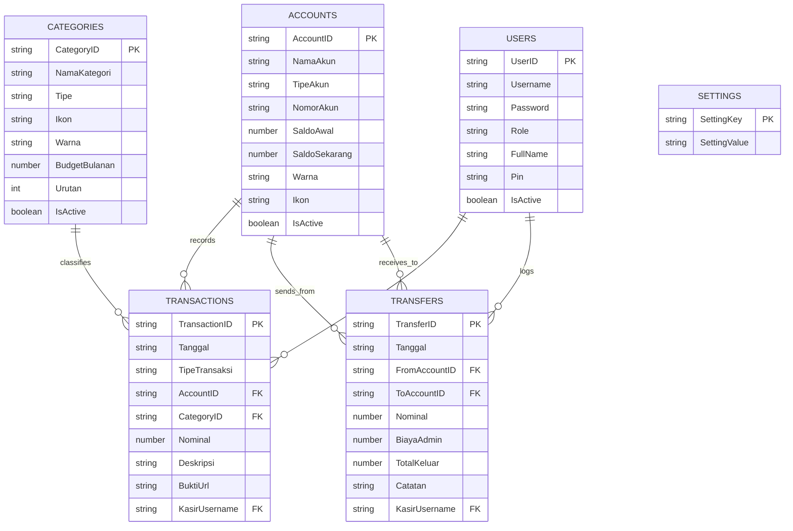

# Deskripsi Aplikasi
**DompetKu (FinansialKu)** adalah aplikasi web pencatatan keuangan pribadi modern berbasis Google Apps Script (GAS), Google Sheets, Alpine.js, dan Tailwind CSS. Aplikasi ini dirancang untuk memudahkan individu dalam melacak seluruh arus kas harian, mengelola multi-dompet (tunai, rekening bank, e-wallet, dan investasi), melakukan transfer/pindah dana antar akun secara real-time, memonitor anggaran belanja (budgeting), serta melihat analitik keuangan yang komprehensif dan responsif baik di desktop maupun mobile (PWA-ready).

Tema Warna Brand:
- Primary: `#059669` (Emerald-600 — simbol kestabilan finansial dan pertumbuhan)
- Secondary: `#047857` (Emerald-700 — deep green elegan)
- Accent: `#f59e0b` (Amber-500 — highlight peringatan anggaran & aksi penting)
- Danger: `#ef4444` (Red-500 — pengeluaran & defisit)
- Success: `#10b981` (Emerald-500 — pemasukan & saldo positif)

---

# Role Akses
- **Pemilik Akun (Admin)**: 
  - Hak akses penuh mengelola akun keuangan (dompet).
  - Input, edit, hapus transaksi pemasukan & pengeluaran.
  - Melakukan transaksi **Pindah Dana (Transfer Antar Akun)** lengkap dengan perhitungan biaya admin.
  - Mengatur kategori pemasukan/pengeluaran dan target anggaran bulanan (budgeting).
  - Melihat laporan visual, neraca saldo, grafik arus kas, serta export data.
  - Mengubah profil, PIN keamanan, dan pengaturan aplikasi.
- **Tamu / Demo (Visitor/Guest)**: 
  - Hanya dapat melihat overview tampilan demo publik atau form login & kunci PIN untuk masuk ke dashboard pribadi.

---

# Menu & Fitur Utama

## 1. Dashboard Ringkasan Finansial
- **Total Net Worth Card**: Menampilkan akumulasi total saldo seluruh akun aktif secara real-time.
- **Ringkasan Arus Kas Bulan Ini**: 
  - Total Pemasukan bulan berjalan.
  - Total Pengeluaran bulan berjalan.
  - Selisih Bersih (Cash Flow Surplus/Defisit).
- **Daftar Akun / Dompet (Wallets Carousel / Grid)**:
  - Kartu visual tiap akun menampilkan Nama Akun, Jenis (Tunai, Bank, E-Wallet), Saldo Terkini, serta aksi cepat (Pindah Dana / Mutasi).
- **Widget Peringatan Anggaran (Budget Alert)**:
  - Menampilkan progress pemakaian anggaran per kategori untuk mendeteksi potensi overspending.
- **Mutasi Terakhir**: 10 transaksi atau pindah dana terbaru dengan indikator badge warna yang jelas.

## 2. Manajemen Akun / Dompet (Multi-Account)
- **Daftar Akun**:
  - Akun Tunai (Dompet Utama, Kas Kecil, dll.)
  - Rekening Bank (BCA, Mandiri, BRI, BNI, Jago, dll.)
  - E-Wallet (GoPay, OVO, DANA, ShopeePay, dll.)
  - Investasi / Tabungan Khusus (Bibit, Reksadana, Logam Mulia, dll.)
- **CRUD Akun**: Tambah akun baru, ubah nama, pilih ikon/warna kartu, set saldo awal, serta opsi nonaktifkan akun.
- **Histori Mutasi Akun**: Klik pada akun untuk melihat rekap riwayat keluar-masuk dana khusus akun tersebut.

## 3. Transaksi (Pemasukan & Pengeluaran)
- **Modal Input Cepat (Quick Add Transaction)**:
  - Toggle Jenis: Pemasukan (Income) atau Pengeluaran (Expense).
  - Pilih Akun Sumber / Akun Penerima.
  - Pilih Kategori (Makan & Minum, Transport, Belanja, Tagihan, Gaji, Bonus, dll.).
  - Input Nominal (rupiah), Tanggal, Catatan/Keterangan, dan opsional Upload Bukti/Struk.
- **Filter & Pencarian Mutasi**:
  - Filter rentang tanggal (Hari ini, Bulan ini, Kustom).
  - Filter berdasarkan Akun dan Kategori.
  - Pencarian berdasarkan catatan/deskripsi.
- **Aksi Transaksi**: Edit dan Hapus transaksi (otomatis mengembalikan/menyesuaikan saldo akun terkait).

## 4. Menu Pindah Dana (Transfer Antar Akun)
- **Fitur Utama Pindah Dana**:
  - Pilih **Akun Asal (Pengirim)**: Saldo akun ini akan berkurang sebesar `Nominal + Biaya Admin`.
  - Pilih **Akun Tujuan (Penerima)**: Saldo akun ini akan bertambah sebesar `Nominal`.
  - Input **Nominal Transfer**.
  - Input **Biaya Admin** (Opsional, misal biaya transfer antar bank Rp 2.500 atau Rp 6.500). Jika diisi, biaya admin otomatis dicatat sebagai pengeluaran dari Akun Asal.
  - Input **Catatan / Keterangan Transfer** (misal: "Top up GoPay dari BCA", "Tarik tunai ATM").
  - Tanggal & Waktu transfer.
- **Log Pindah Dana**:
  - Riwayat perpindahan dana antar akun tersimpan di tabel khusus `Transfers` dan tercatat otomatis di mutasi kedua akun.

## 5. Kategori & Anggaran (Budgeting)
- **Master Kategori**:
  - Kategori Pemasukan: Gaji, Bonus, Investasi, Hadiah, Penjualan, Lainnya.
  - Kategori Pengeluaran: Makanan & Minuman, Transportasi, Belanja Bulanan, Tagihan & Utilitas, Hiburan, Kesehatan, Pendidikan, Zakat/Donasi, Biaya Admin, Lain-lain.
- **Budget Planner**:
  - Tetapkan batas maksimal pengeluaran bulanan per kategori.
  - Indikator bar warna: Hijau (< 70%), Kuning (70-90%), Merah (> 90% atau Over Budget).

## 6. Laporan & Analitik
- **Grafik Distribusi Pengeluaran**: Chart interaktif breakdown pengeluaran berdasarkan kategori.
- **Grafik Tren Arus Kas**: Perbandingan pemasukan vs pengeluaran dari bulan ke bulan.
- **Ekspor Data**: Opsi unduh laporan dalam format CSV / cetak format nota/rekapitulasi.

## 7. Keamanan & Pengaturan
- **Proteksi PIN / Password**: Kunci akses dashboard dengan autentikasi lokal & sesi.
- **Pengaturan Mata Uang & Format**: Format Rupiah (Rp), format tanggal Indonesia (`dd/MM/yyyy`).

---

# Struktur Data (Google Sheets)

**Sheet: Accounts**
| Kolom | Tipe | Keterangan |
|---|---|---|
| AccountID | String | PK: 'ACC-' + timestamp |
| NamaAkun | String | Nama akun/dompet (misal: Tunai Dompet, BCA Utama, GoPay) |
| TipeAkun | String | TUNAI, BANK, EWALLET, INVESTASI |
| NomorAkun | String | Nomor rekening / no HP atau catatan identifikasi |
| SaldoAwal | Number | Saldo awal saat akun pertama kali didaftarkan |
| SaldoSekarang | Number | Saldo mutakhir akun setelah kalkulasi transaksi & transfer |
| Warna | String | Kode warna hex atau kelas styling (misal: #059669) |
| Ikon | String | Nama ikon Font Awesome (misal: fa-wallet, fa-building-columns) |
| IsActive | Boolean | 'TRUE' / 'FALSE' |

**Sheet: Transactions**
| Kolom | Tipe | Keterangan |
|---|---|---|
| TransactionID | String | PK: 'TXN-' + timestamp |
| Tanggal | String | dd/MM/yyyy HH:mm |
| TipeTransaksi | String | PEMASUKAN, PENGELUARAN |
| AccountID | String | FK -> Accounts.AccountID |
| CategoryID | String | FK -> Categories.CategoryID |
| Nominal | Number | Jumlah nominal rupiah transaksi |
| Deskripsi | String | Catatan atau rincian transaksi |
| BuktiUrl | String | Link foto struk / nota (opsional) |
| KasirUsername | String | Username pemilik / pencatat |

**Sheet: Transfers**
| Kolom | Tipe | Keterangan |
|---|---|---|
| TransferID | String | PK: 'TRF-' + timestamp |
| Tanggal | String | dd/MM/yyyy HH:mm |
| FromAccountID | String | FK -> Accounts.AccountID (Akun Pengirim) |
| ToAccountID | String | FK -> Accounts.AccountID (Akun Penerima) |
| Nominal | Number | Jumlah dana yang dipindahkan |
| BiayaAdmin | Number | Biaya transfer/admin (0 jika gratis) |
| TotalKeluar | Number | Kalkulasi: Nominal + BiayaAdmin |
| Catatan | String | Keterangan transfer |
| KasirUsername | String | Username pemilik / pencatat |

**Sheet: Categories**
| Kolom | Tipe | Keterangan |
|---|---|---|
| CategoryID | String | PK: 'CAT-' + timestamp |
| NamaKategori | String | Nama kategori (misal: Makanan, Transport, Gaji) |
| Tipe | String | PEMASUKAN, PENGELUARAN |
| Ikon | String | Font Awesome class (misal: fa-utensils, fa-car, fa-money-bill) |
| Warna | String | Kode warna badge kategori (misal: #10b981, #ef4444) |
| BudgetBulanan | Number | Batas limit anggaran bulanan (0 jika tanpa limit) |
| Urutan | Number | Urutan sorting tampilan |
| IsActive | Boolean | 'TRUE' / 'FALSE' |

**Sheet: Users**
| Kolom | Tipe | Keterangan |
|---|---|---|
| UserID | String | PK: 'USR-' + timestamp |
| Username | String | Username login (default: admin) |
| Password | String | Password login (default: admin123) |
| Role | String | 'admin' |
| FullName | String | Nama lengkap pemilik |
| Pin | String | 6-digit PIN untuk quick lock |
| IsActive | Boolean | 'TRUE' / 'FALSE' |

**Sheet: Settings**
| Kolom | Tipe | Keterangan |
|---|---|---|
| SettingKey | String | PK: Setting identifier (NamaAplikasi, MataUang, SimbolMataUang, dll.) |
| SettingValue | String | Nilai konfigurasi |

---

# Diagram Relasi Data (Mermaid ERD)

---

# Catatan Khusus & Business Logic

1. **Format Identitas & Tanggal**:
   - ID unik: `'PREFIX-' + new Date().getTime()` (ACC-, TXN-, TRF-, CAT-, USR-).
   - Format tanggal disimpan dalam format `dd/MM/yyyy HH:mm`.
   - Nilai boolean selalu string `'TRUE'` atau `'FALSE'`.

2. **Aturan Mutasi Pindah Dana (Transfer Antar Akun)**:
   - Validasi: `FromAccountID` tidak boleh sama dengan `ToAccountID`.
   - Validasi: Nominal transfer harus > 0.
   - Pengecekan saldo: Saldo `FromAccount` harus mencukupi `(Nominal + BiayaAdmin)`.
   - Eksekusi atomik: 
     - Saldo `FromAccount` berkurang `(Nominal + BiayaAdmin)`.
     - Saldo `ToAccount` bertambah `Nominal`.
     - Data dicatat ke sheet `Transfers`.
     - Bila ada `BiayaAdmin > 0`, sistem otomatis menambahkan 1 record transaksi pengeluaran kategori khusus "Biaya Admin Transfer" agar neraca pengeluaran tetap balance.

3. **Aturan Transaksi (Pemasukan & Pengeluaran)**:
   - Transaksi `PEMASUKAN`: Menambah `SaldoSekarang` pada akun terkait sebesar `Nominal`.
   - Transaksi `PENGELUARAN`: Mengurangi `SaldoSekarang` pada akun terkait sebesar `Nominal`.
   - Edit transaksi: Saldo akun disesuaikan dengan selisih perubahan nominal lama dan baru.
   - Hapus transaksi: Saldo akun di-revert (jika hapus pemasukan maka saldo berkurang, jika hapus pengeluaran maka saldo bertambah).

4. **Kalkulasi & Budgeting**:
   - Total Net Worth = Penjumlahan `SaldoSekarang` seluruh akun aktif (`IsActive == 'TRUE'`).
   - Budget Alert: Menghitung persentase `(Total Pengeluaran Kategori Bulan Ini / BudgetBulanan) * 100%`.

5. **Cache Invalidation & Keamanan Backend**:
   - Setiap operasi tulis (`saveAccount`, `saveTransaction`, `saveTransfer`, `deleteTransaction`, dll.) wajib memanggil `clearDataCache()`.
   - Whitelist fungsi pada `doPost` untuk keamanan JSON API endpoint.
   - Respon standar API: `{ success: Boolean, message: String, data?: Any }`.
